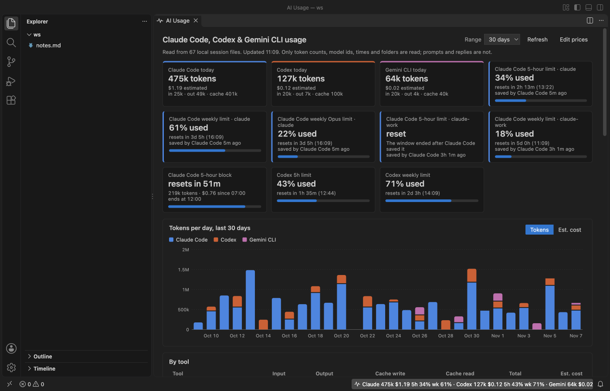
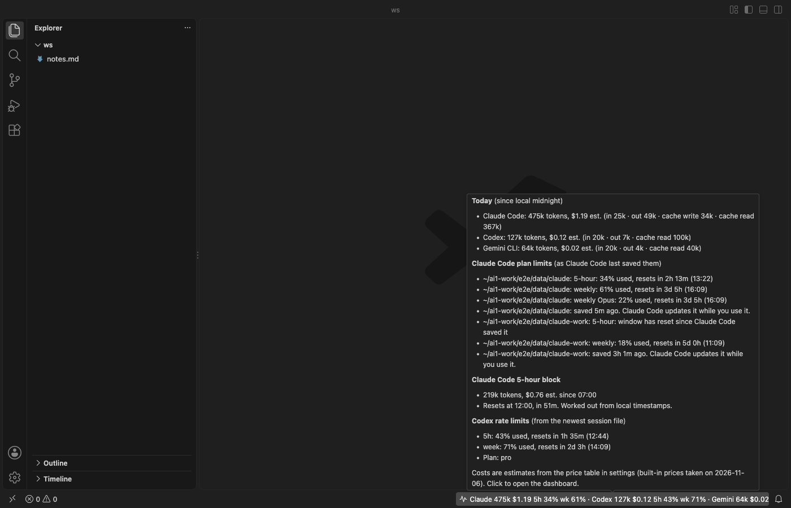
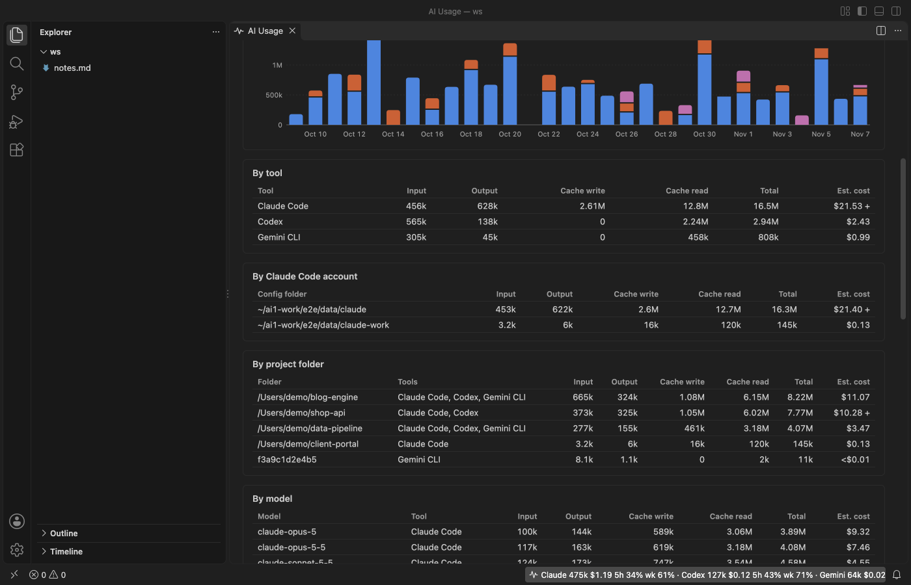
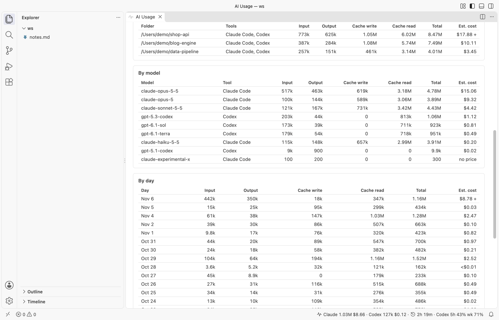
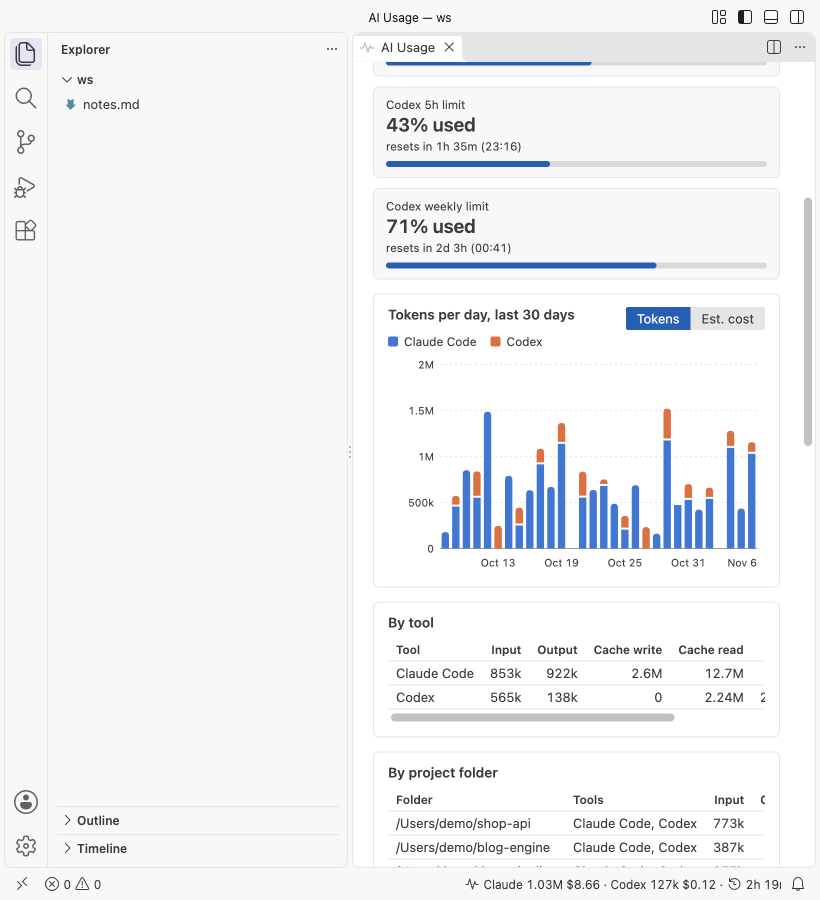

# Claude Code Usage, Codex Usage & Gemini CLI Usage Meter

See your Claude Code 5-hour and weekly limit, plus today's Claude Code, Codex and Gemini CLI tokens and estimated cost, in the VS Code status bar. Everything is read offline from files on your own computer.

The screenshots show the extension running in VS Code 1.142 on synthetic data made by `scripts/make-fixtures.js`. No real session or account was used.

## Why use it

1. Your real Claude Code limit, with no login and no network. Claude Code saves its own last reading of your plan usage (the numbers on claude.ai/settings/usage) in its config file. The meter reads that reading, so the status bar shows `Claude 5h 34% wk 61%` without an API call, a cookie or a token.
2. Three tools in one place. Claude Code, Codex and Gemini CLI usage sit side by side in the status bar and in one dashboard, so you don't need three meters.
3. More than one Claude Code account. If you run several accounts with `CLAUDE_CONFIG_DIR` (for example `~/.claude` and `~/.claude-work`), each folder is found and shown as its own account, with its own limits.
4. Your prompts stay private. The extension reads only token counts, model ids, times, folder paths and limit numbers. It never shows or stores prompt or reply text, never reads your login token, makes no network calls and needs no API key.
5. It stays light. It remembers where it stopped in each file and reads only the new lines, so a 2 GB history doesn't get read again every minute.

Not affiliated with Anthropic, OpenAI or Google. Claude Code, Codex and Gemini CLI are their makers' products, named here only to say what this extension reads.

## Quick start

1. Install the extension. The status bar item appears at the bottom right once it has read your session folders.
2. Click it to open the dashboard, or run "AI Usage: Open Usage Dashboard".

## The status bar

The item reads like `Claude 1.2M $3.40 · Codex 410k $0.62 · Gemini 64k $0.03 · Claude 5h 34% wk 61% · Codex 5h 43% wk 71%`. Hover for the full split, every limit with its reset clock time, and the time since Claude Code saved the reading. The item turns yellow when any limit reaches 90%. Before Claude Code has saved a reading, a clock shows the time left in the current 5-hour block instead.

## The dashboard

- Tiles for today per tool, each Claude Code limit (5-hour, weekly, and weekly Opus or Sonnet when your plan has them), the 5-hour block and each Codex limit.
- A stacked bar chart per day for the last 7, 14, 30 or 90 days, in tokens or in estimated cost. Hover a day for its numbers.
- Tables by tool, by Claude Code account, by project folder, by model and by day. Each has input, output, cache write, cache read, total and estimated cost.

In a narrow editor the tiles stack, the chart redraws to fit and wide tables scroll sideways.

## Where the numbers come from

| Tool | Files read | What is used |
|---|---|---|
| Claude Code | `~/.claude/projects/<folder>/<session>.jsonl`, or `<CLAUDE_CONFIG_DIR>/projects`, plus other `~/.claude-*` and `~/.config/claude` folders | `usage` on each assistant message |
| Claude Code limits | `~/.claude.json`, or `<CLAUDE_CONFIG_DIR>/.claude.json` | only the `cachedUsageUtilization` key that Claude Code saves |
| Codex | `~/.codex/sessions/YYYY/MM/DD/rollout-*.jsonl`, or `<CODEX_HOME>/sessions` | `token_count` events and their rate limits |
| Gemini CLI | `~/.gemini/tmp/<project>/chats/session-*.json` (and `.jsonl`) | `tokens` on each Gemini reply, and `~/.gemini/projects.json` for folder names |

- Claude Code: a message that was written more than once (while it streamed, or again in a resumed session) counts once. Subagent files count too.
- Claude Code limits: the percent is as fresh as Claude Code's last check, which happens while you use it. The tooltip says how long ago that was. A window that has already reset shows "reset" instead of an old percent.
- Codex writes running totals. Each event adds what grew since the one before, so repeated events don't double count. Codex limits come from the newest event that has them.
- Gemini CLI counts cached tokens inside its input number and thinking tokens apart from output. The meter shows cached tokens as cache read and adds thinking tokens to output, since they're billed as output.
- The 5-hour block starts at the hour of your first Claude Code message after a break and lasts 5 hours. It's worked out from local timestamps.
- Days follow your computer's time zone. Records the extension doesn't know and lines that aren't valid JSON are skipped.

## Cost is an estimate

Cost is tokens times a price table in US dollars per million tokens. The built-in prices were taken on 2026-11-06. Gemini rows use Google's paid-tier prices for prompts up to 200k tokens. Change any row, or price a model the table doesn't know, in the `aiUsageMeter.prices` setting. Models without a price still count tokens and are listed under the dashboard. On a Pro, Max, ChatGPT or Gemini plan you aren't billed per token, so treat the cost as what the same work would cost on the API.

## Settings

| Setting | Default | What it does |
|---|---|---|
| `aiUsageMeter.showClaudeCode` | `true` | Show Claude Code usage and limits. |
| `aiUsageMeter.showCodex` | `true` | Show Codex usage and limits. |
| `aiUsageMeter.showGemini` | `true` | Show Gemini CLI usage when its session files are found. |
| `aiUsageMeter.statusBar` | `true` | Show the status bar item. |
| `aiUsageMeter.statusBarCost` | `true` | Show the estimated cost in the status bar. |
| `aiUsageMeter.refreshSeconds` | `60` | Read new lines at least this often. File changes trigger a read within 2 seconds. |
| `aiUsageMeter.historyDays` | `90` | Days of history to read. Older files are skipped. |
| `aiUsageMeter.prices` | `{}` | Your price rows, by model id or prefix. |
| `aiUsageMeter.claudeRoots` | `[]` | Claude Code project folders. Empty means `$CLAUDE_CONFIG_DIR/projects`, else every Claude Code config folder found in your home folder. |
| `aiUsageMeter.findClaudeAccounts` | `true` | With no folder set, also read `~/.claude-*` and `~/.config/claude` folders that hold projects. |
| `aiUsageMeter.codexRoots` | `[]` | Codex session folders. Empty means `$CODEX_HOME/sessions`, else `~/.codex/sessions`. |
| `aiUsageMeter.geminiRoots` | `[]` | Gemini CLI project folders. Empty means `~/.gemini/tmp`. |
| `aiUsageMeter.askForRating` | `true` | Ask once for a Marketplace rating after a few days of use. |
| `aiUsageMeter.showSupportLinks` | `true` | Show the Sponsor and More free viewers links under the dashboard. |

## Privacy

The extension only reads files. It doesn't write, move or delete session or config files, it sends nothing anywhere and it has no telemetry. From the Claude Code config file it keeps only the limit numbers and reset times: not your email, not your account id and not your login token. Lines that can't hold usage data are skipped before they're parsed. The dashboard runs under a strict Content Security Policy with no remote content.

## Known limits

- Usage made on another computer, or in claude.ai, ChatGPT or the Gemini app, isn't in your local files, so it isn't counted.
- The Claude Code limit is only as fresh as Claude Code's last saved reading. Older Claude Code versions don't save one; then the meter shows the 5-hour block clock.
- Codex limits are only as fresh as the last Codex session that wrote them. Gemini CLI doesn't write its quota to disk, so Gemini shows tokens and cost only.
- OpenCode, Cursor and GitHub Copilot usage aren't read yet.

## Support Zovo

Zovo extensions are free, with no ads and no tracking. They are made by [theluckystrike](https://github.com/theluckystrike) on GitHub. If this one saves you time, you can support the work:

- [Sponsor on GitHub](https://github.com/sponsors/theluckystrike)
- [Follow theluckystrike on GitHub](https://github.com/theluckystrike)

## More tools by Zovo

- [Claude Code History & Codex History Viewer](https://marketplace.visualstudio.com/items?itemName=zovo.agent-session-viewer) browses and searches your local Claude Code and Codex sessions.
- [Agent Skills & Claude Skills Manager (Skill Shelf)](https://marketplace.visualstudio.com/items?itemName=zovo.skill-shelf) lists, checks and toggles the Agent Skills that Claude Code, Codex and Cursor load.
- [AGENTS.md & CLAUDE.md Linter (Context Drift)](https://marketplace.visualstudio.com/items?itemName=zovo.context-drift) finds stale commands, paths and versions in AGENTS.md and CLAUDE.md files.
- [JSONL Viewer, Large JSONL Table & NDJSON Viewer](https://marketplace.visualstudio.com/items?itemName=zovo.zovo-jsonl-viewer) opens JSONL and NDJSON files as a table, as records or as a chat view.
- [Large JSON Viewer, JSON Browser & JSON Tree](https://marketplace.visualstudio.com/items?itemName=zovo.zovo-json-tree-viewer) shows large JSON files as a searchable tree, copies JSONPath and turns arrays of objects into a table.

See [all Zovo extensions on the Marketplace](https://marketplace.visualstudio.com/publishers/zovo).
